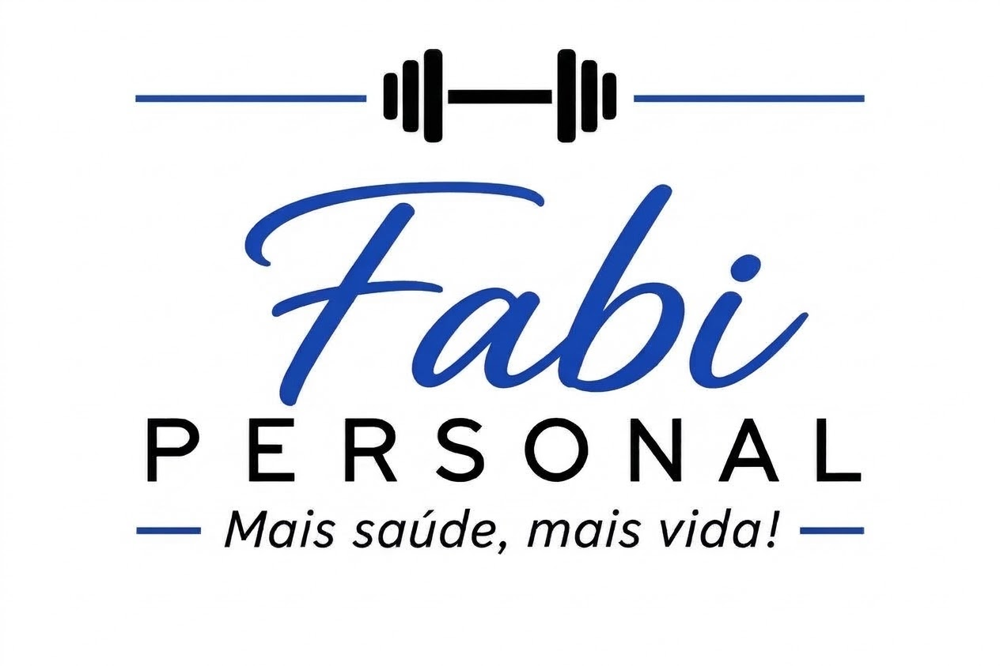
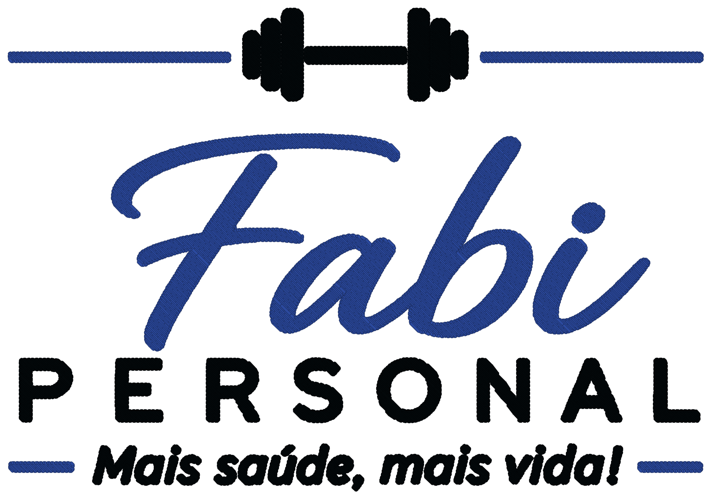

# vet_to_pes

Converte uma imagem (JPG ou PNG) em arquivo de bordado **.PES**, pronto para abrir no **Wilcom Embroidery Studio** ou em máquinas Brother/Babylock.

O script vetoriza a imagem e gera os pontos de bordado: underlay duplo, preenchimento tatami, compensação de repuxo e corte de linha. Ele também salva o vetor em SVG e uma prévia em PNG para você conferir antes de bordar.

| Imagem de entrada | Prévia do bordado gerado |
|---|---|
|  |  |

## Requisitos

- Python 3.8 ou mais recente
- `git`, para clonar o repositório

## Instalação

```bash
git clone https://github.com/rodseidel/vet_to_pes.git
cd vet_to_pes

python3 -m venv .venv
source .venv/bin/activate          # Windows: .venv\Scripts\activate

pip install --upgrade pip
pip install -r dependencies.txt
```

> Se `python3 -m venv` reclamar que o módulo não existe (comum no Ubuntu/Debian), instale com `sudo apt install python3-venv`, ou use `pip install --user virtualenv && python3 -m virtualenv .venv`.

Para conferir se a instalação deu certo:

```bash
python image_to_pes.py --help
```

Toda vez que abrir um terminal novo, ative o ambiente de novo com `source .venv/bin/activate` antes de usar o script.

## Uso rápido

1. Coloque a imagem na pasta `entrada/`.
2. Rode o script passando só o nome do arquivo:

```bash
python image_to_pes.py imagem4.jpeg
```

```
Imagem: 1264x843 px (ampliada 2x para vetorizar)
Bordado: 150.0 x 104.2 mm
Fundo removido: #fcffff
Cor #2b499d: 9 formas
Cor #03080a: 39 formas
PES gerado: saida/imagem4.pes (9774 pontos, 2 cores)
```

Os arquivos de saída ficam em `saida/`:

| Arquivo | Conteúdo |
|---|---|
| `saida/<nome>.pes` | arquivo de bordado |
| `saida/<nome>_vetor.svg` | imagem vetorizada (também pode ser importada no Wilcom) |
| `saida/<nome>_preview.png` | prévia dos pontos com a espessura real da linha |

## Opções mais usadas

| Opção | Padrão | Para que serve |
|---|---|---|
| `-c, --colors` | `3` | número de cores **contando o fundo** (logo de 2 cores em fundo branco = 3) |
| `-w, --width-mm` | `150` | largura final do desenho em mm |
| `-H, --max-height-mm` | `150` | altura máxima em mm (reduz mantendo a proporção) |
| `--density` | `0.30` | espaçamento do preenchimento em mm; maior = menos denso |
| `--pull-comp` | `0.25` | compensação de repuxo em mm; reduza se letras pequenas grudarem |
| `--outline` | desligado | contorno em ponto corrido, deixa as bordas mais nítidas |
| `-i, --input-dir` | `entrada` | pasta de onde as imagens são lidas |
| `-d, --output-dir` | `saida` | pasta onde os arquivos são gravados |

Exemplos:

```bash
# bastidor 100 x 100 mm, 4 cores (contando o fundo), com contorno
python image_to_pes.py logo.png -w 100 -H 100 -c 4 --outline

# imagem fora da pasta entrada/ e saída em outra pasta
python image_to_pes.py ~/Downloads/logo.png -d entregas/cliente_x
```

A lista completa de parâmetros, como abrir o arquivo no Wilcom e dicas de qualidade estão em [ROTEIRO_EXECUCAO.md](ROTEIRO_EXECUCAO.md).

## Dicas

- Logos com cores chapadas e fundo liso dão o melhor resultado. Fotos e imagens com fundo degradê costumam precisar de tratamento antes.
- Traços com menos de ~1 mm no tamanho final ficam ilegíveis. Aumente `-w` ou refaça o texto com uma fonte de bordado no Wilcom.
- O PES abre no Wilcom como pontos. Para mudar o tamanho, gere de novo com `-w` em vez de redimensionar mais de 10–20%.
- Sempre confira o `_preview.png` e faça um teste em retalho antes de bordar a peça.

## Estrutura

```
.
├── image_to_pes.py        # script principal
├── dependencies.txt       # dependências Python
├── ROTEIRO_EXECUCAO.md    # guia detalhado
├── entrada/               # imagens de entrada
└── saida/                 # arquivos gerados (.pes, .svg, .png)
```
